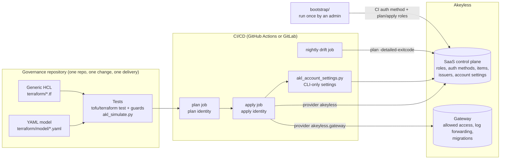

# Architecture

## Components

## Identities

| Identity | Created by | Bound to | Can |
|---|---|---|---|
| Account admin (human) | Akeyless account | - | run `bootstrap/` once; break-glass |
| CI auth method `/governance/auth/ci-terraform` (OAuth2/JWT) | `bootstrap/` | CI OIDC issuer (GitHub or GitLab) | authenticate pipelines, nothing by itself |
| Role `.../terraform-plan` | `bootstrap/` | CI auth method, sub-claim = repository | read RBAC/auth config, list items, read `/pki/*` |
| Role `.../terraform-apply` | `bootstrap/` | CI auth method, sub-claims = repository **and** protected main branch | administer everything it manages (admin-equivalent, because Akeyless forbids granting what you do not hold) |
| Everything in `terraform/model` | main pipeline | as modelled | as modelled |

The CI identity lives in a separate state (`bootstrap/`), so the main pipeline can never destroy
its own access.

## What runs where

| Object family | API endpoint | Terraform provider |
|---|---|---|
| Roles, rules, associations, auth methods, folders, issuers, keys, custom fields, key policies, event forwarders, account settings | `https://api.akeyless.io` (or a Gateway's `/api/v2`, which proxies the API) | `akeyless` |
| Gateway allowed access, log forwarding, migrations | the Gateway API (`https://<gw>:8000/api/v2` or `:8081`) | `akeyless.gateway` (alias) |
| Account settings not exposed by the provider | REST `/auth` + CLI `update-account-settings` | - (`scripts/akl_account_settings.py`) |

One Gateway cluster per state: for several clusters, run the same code with one workspace or
var-file per cluster (`gateway_api` and `model/gateway.yaml` differ).

## Change flow

1. Engineer edits YAML (normally only `model/roles/<bu>.yaml`) and opens a merge request.
2. `checks`: format, validate, `terraform test` (20+ cases, mocked provider), guard-message proof,
   offline access expectations (`akl_simulate.py`), script tests.
3. `plan` with the plan identity; reviewers read the plan (CODEOWNERS: BU + platform).
4. Merge -> `apply` (protected environment, manual approval) -> CLI-only account settings.
5. Optional: `akl_verify.py` with test personas proves effective access live.
6. On demand, `watchover reconcile` compares the repository with Akeyless and writes a report and patch for a
   person to review and commit (agents never commit or push to the governance repository).
7. Nightly `drift` fails when someone changed Akeyless outside Git; the next apply reverts it
   (role rules are authoritative).
